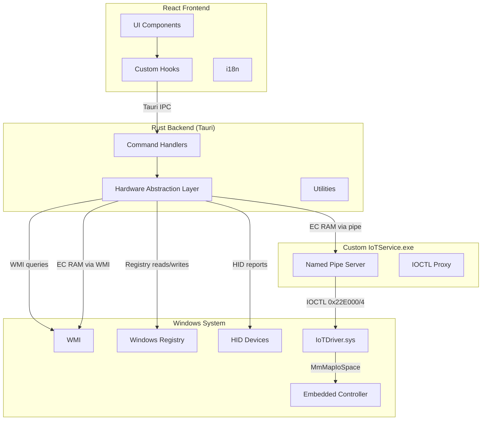

# miPC Architecture

## Overview

miPC is a Windows desktop application built with Tauri v2, React 19, and Rust. It provides hardware control and monitoring for Xiaomi laptop hardware.

## Technology Stack

| Layer    | Technology                 |
| -------- | -------------------------- |
| Frontend | React 19, TypeScript, Vite |
| Backend  | Rust, Tauri v2             |
| Platform | Windows 10/11              |
| Build    | pnpm, Cargo                |

## Architecture Diagram

## Hardware Abstraction Layer (HAL)

The HAL is the core of the backend. Each hardware module in `src-tauri/src/hw/` encapsulates access to a specific hardware subsystem. The table below is the full inventory (55 modules as of 2026-11-11).

### Power, thermal and performance

| Module                | Responsibility                                                            |
| --------------------- | ------------------------------------------------------------------------- |
| `adapter_power.rs`    | AC-adapter power reading (WMAA `0x1000 / 0x06`) with a bounded retry gate |
| `battery.rs`          | Battery level, health, charge/discharge rates, AC adapter (WMI)           |
| `battery_test.rs`     | Battery diagnostic helpers                                                |
| `charging.rs`         | Charging limit ("Battery Care") — firmware-authoritative path             |
| `fan.rs`              | Fan speed and mode control (WMI MICommonInterface)                        |
| `performance.rs`      | Performance mode selection and power profile management                   |
| `performance_test.rs` | Performance-mode test helpers                                             |
| `thermal.rs`          | Thermal zone monitoring via `MSAcpi_ThermalZoneTemperature`               |
| `power_listener.rs`   | Power event listener — sleep/resume and lid state                         |
| `scenario_rules.rs`   | Automatic performance-mode switching driven by power events               |
| `os_turbo.rs`         | OS Turbo — system-level software optimization                             |
| `os_turbo_policy.rs`  | Bounded, allowlisted adaptive policy for OS Turbo                         |
| `os_turbo_stats.rs`   | Deterministic windowed statistics for OS Turbo                            |
| `os_turbo_log.rs`     | Anonymous, bounded action log for OS Turbo                                |
| `os_turbo_suggest.rs` | Optional BYOK suggestion adapter for OS Turbo                             |
| `sys_opt.rs`          | System Optimization — Windows debloat and telemetry reduction             |

### Display, audio and input

| Module                 | Responsibility                                                      |
| ---------------------- | ------------------------------------------------------------------- |
| `display.rs`           | Display brightness, refresh rate, HDR                               |
| `panel_edid.rs`        | Panel identity from the monitor's EDID (`root\WMI` `WmiMonitorID`)  |
| `color_calibration.rs` | ICC colour profile management via the Windows ICM API (`mscms.dll`) |
| `icc_catalog.rs`       | Curated ICC catalogue: validation, download and staged installation |
| `eye_protection.rs`    | Eye protection / blue-light filter                                  |
| `osd.rs`               | Native Win32 brightness OSD overlay                                 |
| `audio.rs`             | Audio device enumeration and volume control (Core Audio)            |
| `audio_effects.rs`     | Audio effects — user preferences with honest capability reporting   |
| `mic.rs`               | System-level microphone mute (WASAPI)                               |
| `touchpad.rs`          | Touchpad haptics, sensitivity, gestures, edge slide                 |
| `fn_key.rs`            | Fn-key customisation — Fn-lock toggle and function-key behaviour    |
| `hotkeys/`             | Keyboard hotkey detection and remapping                             |

### EC / firmware

| Module                  | Responsibility                                                      |
| ----------------------- | ------------------------------------------------------------------- |
| `ecram.rs`              | EC RAM access (IOCTL + pipe client for the custom IoTService.exe)   |
| `ecram_service_mgmt.rs` | Management of the custom ecram_service (IoTService.exe replacement) |
| `wmi_ec.rs`             | WMI-based EC read/write (MICommonInterface, `root\WMI`)             |
| `hq_wmi.rs`             | HQWmiCommonInterface — BIOS/EC control via WMI                      |
| `wmi_cache.rs`          | Cached WMI session for reuse                                        |
| `iotservice.rs`         | IoTService.exe IPC client for Xiaomi hardware control               |
| `iot_events.rs`         | IoT event listener — turns power/EC events into native OSD          |
| `iot_watchdog.rs`       | IoT pipe watchdog                                                   |
| `event_log.rs`          | Application event-log archival (elevated)                           |

### System, processes and maintenance

| Module               | Responsibility                                                             |
| -------------------- | -------------------------------------------------------------------------- |
| `overview.rs`        | Overview snapshot — single data source for the Overview tab                |
| `system_info.rs`     | System information queries (CPU, memory, OS version)                       |
| `discovery.rs`       | Hardware discovery and profile persistence                                 |
| `processes.rs`       | Per-process resource usage snapshot                                        |
| `taskmgr.rs`         | Global task manager backend — per-process resource accounting              |
| `startup.rs`         | MiControl's own autostart entry                                            |
| `startup_manager.rs` | Windows startup manager — Run keys, Startup folders, logon scheduled tasks |
| `cleanup.rs`         | System cleanup — junk file scanning and removal                            |
| `security_scan.rs`   | Security scanning via Windows Defender CLI (`MpCmdRun.exe`)                |
| `update.rs`          | Driver and BIOS update checking via the Xiaomi PC Manager registry cache   |
| `crash_recovery.rs`  | Crash recovery and application resilience                                  |
| `errors.rs`          | Structured error types for hardware operations                             |

### Connectivity and cross-device

| Module             | Responsibility                                                         |
| ------------------ | ---------------------------------------------------------------------- |
| `wifi.rs`          | WiFi scanning, connection, status via `netsh wlan`                     |
| `screen_cast.rs`   | Miracast/WiDi device discovery and casting                             |
| `phone_link.rs`    | Phone Link integration — detect, launch, monitor                       |
| `localsend.rs`     | LocalSend protocol v2.2                                                |
| `scrcpy_bridge.rs` | scrcpy orchestration — phone camera as webcam                          |
| `syncthing.rs`     | Syncthing REST client — status, folders, folder toggle                 |
| `kde_connect.rs`   | KDE Connect discovery + plugins                                        |
| `nfc_pairing.rs`   | NFC pairing guidance + NDEF handshake payloads                         |
| `ble_scan.rs`      | BLE device discovery for the Cross-Device tab                          |
| `ble_advertise.rs` | BLE advertising (PC discoverability)                                   |
| `ble_presence.rs`  | BLE phone presence monitor                                             |
| `transcription.rs` | Local speech transcription via the sherpa-onnx CLI                     |
| `face/`            | Face Unlock — camera, liveness, matcher, credential vault, pipe server |

## EC RAM Access Architecture

MiControl accesses the Embedded Controller (EC) RAM through two paths:

### 1. WMI Path (no driver required)

Most hardware features work via WMI (`MICommonInterface` in `root\WMI`):

- Performance mode (ACPI WMAA method)
- Battery health and charge thresholds
- Fan speed monitoring
- AC adapter power status

This path only requires admin privileges — no process name check.

### 2. IoTDriver.sys Path (requires custom IoTService.exe)

Direct EC RAM access via IOCTLs (`0x22E000` READ, `0x22E004` WRITE) requires:

- Process named `IoTService.exe`
- Located in the DriverStore directory
- Only 3 hardcoded physical address ranges are accessible

A custom replacement binary (`src-tauri/src/bin/ecram_service.rs`) was built to satisfy these requirements. It provides:

- Named pipe IPC server at `\\.\pipe\ecram_service` (JSON protocol)
- ECRAM read/write proxy to IoTDriver.sys
- CLI mode for testing
- Windows service mode for production

MiControl's `ecram.rs` module includes a pipe client (`read_ecram_via_pipe()`) that communicates with this service.

**Limitation**: ERAM (`0xFE0B0300`) and SMA2 (`0xFE0B0A00`) regions are NOT accessible via IoTDriver.sys — the driver's hardcoded address ranges do not include them. However, AC adapter wattage (ADPW) IS available via WMI (ACPI WMAA method), not through the driver. See [RE_ANALYSIS_REPORT.md](./RE_ANALYSIS_REPORT.md) for details.

## Processes and binaries

| Binary                     | Role                                                                                                                                                                                             |
| -------------------------- | ------------------------------------------------------------------------------------------------------------------------------------------------------------------------------------------------ |
| `micontrol.exe`            | The Tauri app (unprivileged). All UI, all read paths, and every write that does not need elevation.                                                                                              |
| `micontrol.exe --elevated` | Short-lived elevated helper spawned by the app for one-off privileged operations. Writes `tauri-app-helper.log`.                                                                                 |
| `micontrol_bridge.exe`     | Windows service (`NT AUTHORITY\SYSTEM`) exposing `\\.\pipe\micontrol_bridge`. Executes privileged commands over an HMAC-signed JSON protocol, so the app never prompts UAC. Also drives updates. |
| `ecram_service.exe`        | Custom `IoTService.exe` replacement — EC RAM IOCTL proxy on `\\.\pipe\ecram_service`. Must be deployed as `IoTService.exe` in the DriverStore.                                                   |
| `micontrol_face_svc.exe`   | LocalSystem service for Face Unlock (`face` Cargo feature). Serves `\\.\pipe\micontrol_face` to the credential provider.                                                                         |
| `micontrol_facecp.dll`     | Credential Provider COM DLL loaded by `LogonUI.exe` (`face` feature).                                                                                                                            |
| `micontrol_setup.exe`      | Static installer shell (`src-tauri/shell/`). See [installer-decoupling.md](./installer-decoupling.md).                                                                                           |

Command handlers live in `src-tauri/src/commands/` (`ai.rs`, `ai_logs.rs`, `credentials.rs`, `crossdevice.rs`, `face.rs`, `hardware.rs`, `hotkeys.rs`, `privacy.rs`, `system.rs`) and are registered in the `generate_handler!` list in `src-tauri/src/lib.rs`.

## Adding a New Hardware Feature

See [Adding a Hardware Feature](./adding-a-hardware-feature.md) for a step-by-step guide.

## Security Model

- **HMAC-signed elevated bridge** for privileged operations
- **Consent-gated telemetry** with audit logging
- **API keys stored in OS keyring** (never exposed to frontend)
- **CSP-compliant** frontend (no unsafe-inline)
- **ECRAM write guard-rails** with allowlist and env-gated raw writes

## Data Flow

1. User interacts with React UI
2. Hook calls Tauri command via `invoke()`
3. Command handler processes request
4. HAL module accesses hardware via:
   - **WMI** — Performance mode, battery, fan, adapter power
   - **Registry** — App settings, startup config
   - **HID** — Keyboard, touchpad
   - **EC RAM (via pipe)** — IOT_STATUS, IOT_SENSORS, ECRAM sensor block (through custom IoTService.exe)
   - **EC RAM (via WMI)** — EC read/write via MICommonInterface
5. Result returned through Tauri IPC
6. Hook updates React state
7. UI re-renders
