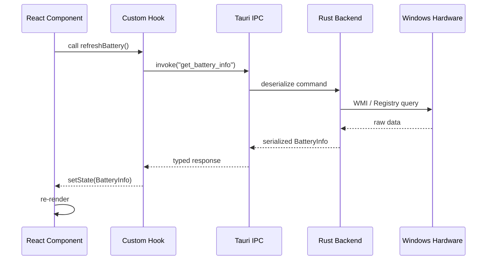
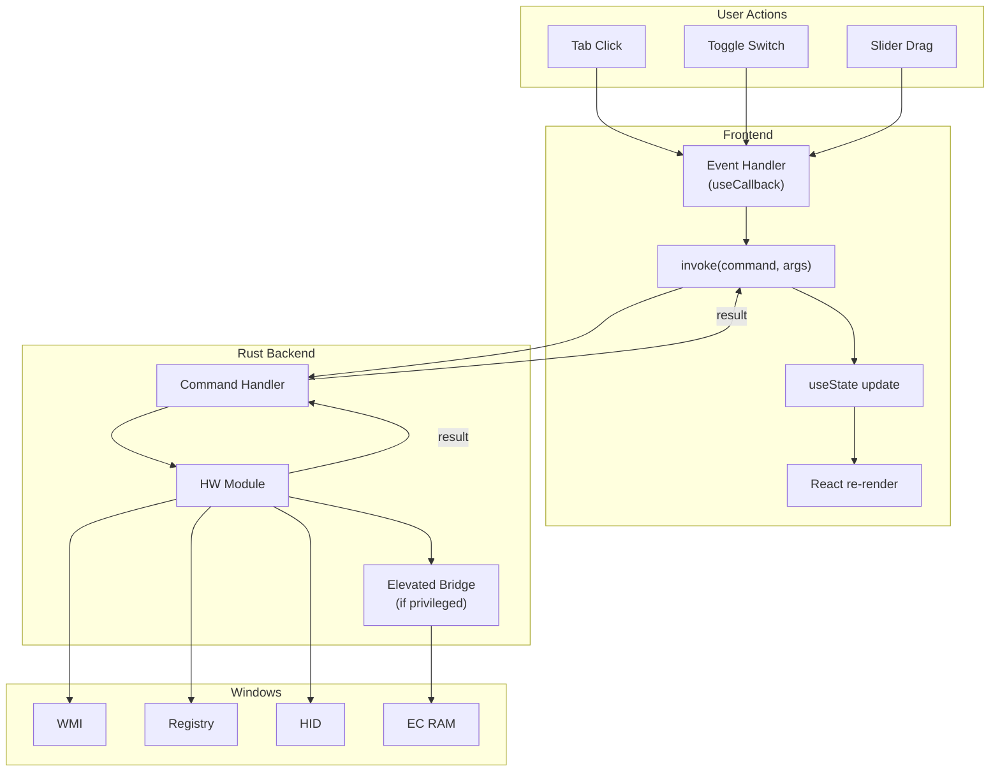

# Frontend Architecture

## Overview

miPC's frontend is built with **React 19**, **TypeScript**, and **Vite**, communicating with the Rust backend through **Tauri v2 IPC** (`invoke`). It is a three-window app (main window, tray popup, brightness OSD) whose main window uses a grouped sidebar with lazy-loaded tab content.

---

## Technology Stack

| Layer        | Technology                             |
| ------------ | -------------------------------------- |
| Framework    | React 19                               |
| Language     | TypeScript 5.8                         |
| Bundler      | Vite 6                                 |
| IPC          | @tauri-apps/api/core (invoke)          |
| Styling      | Hand-written CSS + design tokens       |
| i18n         | Custom module (`src/hooks/useI18n.ts`) |
| Testing      | Vitest + Testing Library               |
| Code Quality | ESLint, Prettier, TypeScript           |

---

## Component Hierarchy

```mermaid
graph TD
    App -->|window=tray?| TrayPopup
    App -->|window=main| MainWindow
    App -->|window=brightness-osd| BrightnessOsd

    subgraph MainWindow["MainWindow"]
        Sidebar
        TabContent
        ConsentDialog
        PrivacyPolicy
    end

    Sidebar --> NavItem1["overview"]
    Sidebar --> NavItem2["taskmgr"]
    Sidebar --> NavItem3["system"]
    Sidebar --> NavItem4["startup"]
    Sidebar --> NavItem5["battery"]
    Sidebar --> NavItem6["performance"]
    Sidebar --> NavItem7["fan"]
    Sidebar --> NavItem8["display"]
    Sidebar --> NavItem9["color"]
    Sidebar --> NavItem10["audio"]
    Sidebar --> NavItem11["iot"]
    Sidebar --> NavItem12["crossDevice"]
    Sidebar --> NavItem13["touchpad"]
    Sidebar --> NavItemAll["... (23 destinations in 5 groups)"]

    TabContent --> LazyTabs["lazy() loaded tabs (24)"]
    LazyTabs --> OverviewTab
    LazyTabs --> TaskManagerTab
    LazyTabs --> SysOptTab
    LazyTabs --> PerformanceTab
    LazyTabs --> BatteryTab
    LazyTabs --> DisplayTab
    LazyTabs --> ColorTab
    LazyTabs --> FanTab
    LazyTabs --> AudioTab
    LazyTabs --> CastTab
    LazyTabs --> IotTab
    LazyTabs --> WiFiTab
    LazyTabs --> TouchpadTab
    LazyTabs --> StartupTab
    LazyTabs --> KeyboardTab
    LazyTabs --> SecurityTab
    LazyTabs --> CrossDeviceTab
    LazyTabs --> CleanupTab
    LazyTabs --> FaceUnlockTab
    LazyTabs --> AiAnalysisTab
    LazyTabs --> SettingsTab
    LazyTabs --> AboutTab
    LazyTabs --> EcrDebugTab["EcrDebugTab (dev only)"]

    subgraph TrayPopup["TrayPopup"]
        TrayPerformance
        TrayBattery
        TrayQuickActions
    end
```



### Key Components

| Component       | Path                               | Description                                   |
| --------------- | ---------------------------------- | --------------------------------------------- |
| `App`           | `src/App.tsx`                      | Root component; theme, Sentry, window routing |
| `MainWindow`    | `src/pages/MainWindow.tsx`         | Main app window with sidebar + tab content    |
| `TrayPopup`     | `src/pages/TrayPopup.tsx`          | System tray popup with quick controls         |
| `Sidebar`       | (inline in MainWindow)             | `React.memo`-optimized navigation sidebar     |
| `BrightnessOsd` | `src/components/BrightnessOsd.tsx` | On-screen brightness overlay                  |

---

## State Management

React built-in hooks are used throughout; there is no external state management library.

```mermaid
graph LR
    subgraph Hooks["Custom Hooks"]
        useHardware
        useI18n["useI18n (t)"]
        useSettings
        useAnalysisLogger
    end

    subgraph Context["Contexts"]
        ToastContext["ToastProvider"]
    end

    useHardware -->|invoke| RustCommands["Rust Commands"]
    useHardware -->|state| TabComponents["Tab Components"]
    useI18n -->|t()| AllComponents["All Components"]
    useSettings -->|persist| localStorage
    ToastContext -->|notifications| AllComponents
```

### Custom Hooks

| Hook                  | File                               | Responsibility                                                                                                     |
| --------------------- | ---------------------------------- | ------------------------------------------------------------------------------------------------------------------ |
| `useHardware`         | `src/hooks/useHardware.ts`         | Central hardware state (CPU, GPU, battery, fan, display, audio, touchpad, keyboard), refresh and error aggregation |
| `useI18n`             | `src/hooks/useI18n.ts`             | Custom i18n store (`t()`, `LOCALES`, `SUPPORTED_LOCALES`) over `useSyncExternalStore` — no react-i18next           |
| `useSettings`         | `src/hooks/useSettings.ts`         | Persistent user preferences via localStorage                                                                       |
| `useOverview`         | `src/hooks/useOverview.ts`         | Overview snapshot (identity, thermals, memory, storage, battery)                                                   |
| `useAiAnalysis`       | `src/hooks/useAiAnalysis.ts`       | AI analysis request/response, daily-limit accounting                                                               |
| `useAnalysisLogger`   | `src/hooks/useAnalysisLogger.ts`   | AI analysis event logging                                                                                          |
| `useAutoUpdate`       | `src/hooks/useAutoUpdate.ts`       | Updater plugin state and install flow                                                                              |
| `useBatteryCare`      | `src/hooks/useBatteryCare.ts`      | Charging-limit (Battery Care) state                                                                                |
| `usePowerProfiles`    | `src/hooks/usePowerProfiles.ts`    | Windows power-profile switching                                                                                    |
| `useTelemetryConsent` | `src/hooks/useTelemetryConsent.ts` | Telemetry consent in the OS credential store                                                                       |

### Key Patterns

- **`useState` / `useEffect`** — Local component state and side effects (e.g., IPC calls on mount).
- **`useCallback`** — Memoized event handlers passed to child components.
- **`React.memo`** — Applied to `Sidebar` to prevent unnecessary re-renders on tab switches.
- **Lazy loading** — All tab pages use `React.lazy()` + `Suspense` for code splitting.

---

## Routing

miPC uses **tab-based navigation** driven by a `useState` string (no router library). `App` holds `activeTab` (persisted in `localStorage` under `micontrol_active_tab`), and `MainWindow` renders `NAV_GROUPS` — five labelled groups (System, Energy, Display & sound, Devices, Settings) with Settings pinned outside the scroll area — as buttons. Clicking a destination updates `activeTab`, which `renderTab()` maps to the corresponding lazy-loaded page.

```typescript
const [activeTab, setActiveTab] = useState(
  () => localStorage.getItem('micontrol_active_tab') ?? 'overview',
);

// Sidebar button onClick → onTabChange('battery')
// renderTab() → <BatteryTab /> when activeTab === 'battery'
```

`Alt+1` … `Alt+9` jump to the first nine destinations (`SHORTCUT_TABS`). The sidebar also has a search field that filters destinations by their translated label.

Window type is determined by a URL query parameter (`?window=main`, `?window=tray`, `?window=brightness-osd`) set by Tauri at window creation.

---

## Internationalization (i18n)

| Locale     | File               |
| ---------- | ------------------ |
| English    | `src/i18n/en.json` |
| Portuguese | `src/i18n/pt.json` |
| Spanish    | `src/i18n/es.json` |
| French     | `src/i18n/fr.json` |

- **Library**: none — a small custom module (`src/hooks/useI18n.ts`) backed by `useSyncExternalStore`
- **Initialization**: module-level locale detection (`localStorage` key `micontrol_lang`, then `navigator.language`, falling back to `en`); `setDocumentDir()` sets `<html lang>` and `dir`
- **Usage**: `t('nav.overview')` or `t('battery.chargeThreshold')`; keys are typed from `en.json` (`StringKey`), so a missing key is a TypeScript error
- **Locale switching**: stored in `localStorage`; `SUPPORTED_LOCALES` drives the picker
- **Completeness gate**: `pnpm run i18n:check` (`scripts/check-i18n.mjs`) fails on missing/extra keys

---

## IPC (Tauri invoke)

All communication with the Rust backend happens through `@tauri-apps/api/core`'s `invoke()` function. Each hardware domain has typed interfaces.



Type definitions live in `src/types/` (`hardware.ts`, `settings.ts`, `charge.ts`, `error.ts`); hooks import from there rather than re-declaring shapes.

---

## Styling

- **Hand-written CSS** — `src/styles/globals.css` (tokens, layout, components) and `src/styles/primitives.css`, plus per-feature CSS files next to their components (e.g. `src/pages/tabs/color.css`). There is no CSS framework.
- **Design Tokens** — CSS custom properties for colours, spacing, and typography. Theme switching (`light`/`dark`/`auto`) is driven by the `data-theme` attribute on `<html>`.
- **`prefers-reduced-motion`** — All animations respect the user's motion preferences.

---

## Data Flow



---

## Testing

| Tool                        | Usage                       |
| --------------------------- | --------------------------- |
| Vitest                      | Test runner                 |
| @testing-library/react      | Component testing           |
| @testing-library/user-event | User interaction simulation |
| jsdom                       | DOM environment             |

Tests are located in `src/__tests__/` and cover component rendering, user interactions, and i18n correctness.
